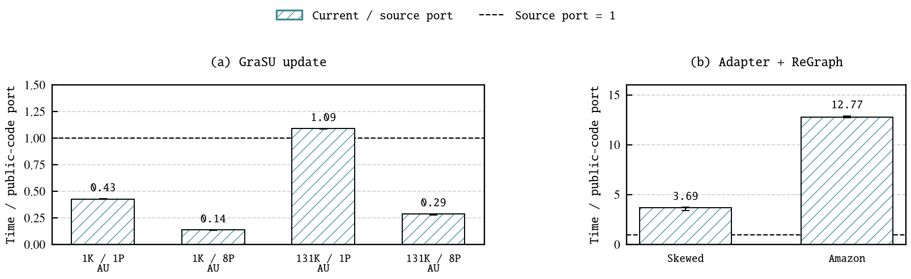

# Public-Source Performance Retention

## Decision

**G passes the declared overhead gate on four AU configurations. R fails on
both supported inputs. This is not evidence that both latest stages retain
public-code performance with only small adaptations.** No paper was edited;
the Figures 7--11 handoff remains unchanged.

The gate, written before execution, allows at most 15% extra elapsed time per
matched row; improvements are allowed. It is an overhead gate, not a
symmetric timing-accuracy test. These are real U55C board measurements, not
simulator predictions or reproductions of the original publications' numbers.
The two panels have independent vertical scales. Below one is faster.



| Stage / input | Public-code port, ms | Current path, ms | Current / port | Gate |
| --- | ---: | ---: | ---: | --- |
| G / AU, 1,024 updates, 1 partition | 2.064 | 0.883 | 0.428 | Pass |
| G / AU, 1,024 updates, 8 partitions | 16.304 | 2.248 | 0.138 | Pass |
| G / AU, 131,072 updates, 1 partition | 4.570 | 4.985 | 1.091 | Pass |
| G / AU, 131,072 updates, 8 partitions | 18.459 | 5.310 | 0.288 | Pass |
| R / skewed-source | 0.320 | 1.180 | 3.693 | Fail |
| R / Amazon | 5.497 | 70.210 | 12.774 | Fail |
| R / boundary-ring | Not paired | Unsupported | Not plotted | 64 duplicate edges |

Values are the ratio of the two arms' medians over warm repetitions 1--3.
Cold repetition 0 is retained but excluded consistently. Whiskers are
`min(current)/max(port)` through `max(current)/min(port)`, not confidence
intervals. No timing coefficient or frequency normalization is applied.
The four G configurations share one real AU topology and update prefixes;
they are not four independent datasets or an eight-graph performance claim.

## Where To Look

| File | Purpose |
| --- | --- |
| [comparison.csv](data/comparison.csv) | Plot-ready paired medians, extrema and gates |
| [repetitions.csv](data/repetitions.csv) | All cold/warm repetitions used in the analysis |
| [summary.json](data/summary.json) | Exact results, unsupported case and report identities |
| [artifacts.json](data/artifacts.json) | Absolute local binary paths, SHA256, compiler and source identities |
| [PDF](figures/source_retention.pdf) | Vector figure |
| [Raw board evidence](evidence/raw_board.tar.gz) | Successful runs, timestamp events, outputs and retained failures |
| [Inputs](evidence/inputs.tar.gz) | Unchanged G and all three declared R inputs |
| [Final reproduction code](evidence/reproduction_sources.tar.gz) | Python runner/analysis/plot/packager, C++ candidate and focused tests |
| [Execution-time sources](evidence/execution_sources_v3.tar.gz) | Candidate dependencies and frozen original G/R host sources |
| [Earlier source snapshot](evidence/execution_sources_v2.tar.gz) | Retained failed host attempt |
| [Production source review](evidence/production_source_review.tar.gz) | Current HLS/includes for review, not bitstream build attestation |
| [Manifest](manifest.json) | Content identities of the delivery files |

The source owner is
`spine_cycle_sim.experiments.original_regraph_execution.hardware.source_retention`;
the new C++ probe is `cpp/tests/publication_sources/source_retention/`.
No production kernel or simulator timing model was changed for this study.

## Measurement Boundary

Both sides start with graph and vertex state resident. Time is the earliest
participating CU start through the latest participating CU end, including
host-induced gaps between kernels inside that interval. Overlapping CU
durations are **not** summed. Initial preparation, upload, state restore,
post-completion readback and CPU validation are excluded from both arms.
R's host-enqueue-to-finish wall time is also retained separately.
This is neither setup-inclusive end-to-end latency nor update-to-convergence.

Each run restores the same initial state. All G runs validate the entire PMA
against the update oracle. Original R validates its full guarded allocations;
current R validates all rank, residual, source, output and degree vectors,
plus completion status and visited-vertex count. Its gather residual must
equal the independent CPU sum exactly. Current R does not add canaries to
every PMA/row input allocation; do not equate these validation scopes.

Execution used U55C device 1, BDF `0000:c1:00.1`, CPU affinity `124,125`,
an exclusive board lease, an 8-GiB cgroup limit, 7-GiB high watermark and zero
swap, with at least 32 GiB available before admission. Per-campaign memory
peaks and OOM counters are retained in the raw reports. The new probe was
compiled with `g++ -std=c++20 -O2 -DNDEBUG -Wall -Wextra -Wpedantic -Werror`.
The highest campaign memory peak was 1,702,060,032 bytes (1.59 GiB), with
zero OOM events. Five focused Python tests, fifteen repository-organization
tests, Python compilation and the C++ strict-warning syntax check pass.

## G: Matched Update Control

The AU input has 515,281 vertices, 390,847 initial edges and 131,072 insertion
updates. The small batch uses the first 1,024 updates. Each matched pair uses
the same prepared PMA, capacity reservation, update prefix and partitioning.
Partition capacities are 524,288 or 65,536 vertices, giving one or eight
partitions. This control launches the nine G CUs per partition, not R.

The reference preserves the author HLS kernels and URAM cache. Its U55C port
uses an external metadata fan-in to accommodate the author's memory
interfaces. It is not an unchanged original-platform binary. The current arm
uses the production SSSP G+R binary's G stage, with bounded cache extent,
four metadata replicas and the weighted/local-destination ABI. Four PMA
lanes use banks `0/1/2/3` in the reference versus `0/6/12/18` in the current
control. This is a fixed four-bank control, not the 23-bank full-graph runtime
placement. Both bitstreams expose a 150-MHz DATA clock; inspect their saved
`xclbin_info` files for exact metadata.

Thus the result bounds the current G overhead on this declared control;
the much faster small/partitioned rows also reflect reduced cache work.
It does not prove that the adaptations are insignificant, that all workloads
match, or that the GraSU publication's original-platform numbers reproduce.

## R: Common Superstep, Disclosed Differences

The reference is public-source ReGraph A4: four Little frontends, no Big,
and shared merge/apply. It is **not** the paper's 11-Little/3-Big example.
The source revision is `365456826cef495285383d939907f847e05ad74b`.
Only the original host's `baseline` launch mode enters the comparison;
`prebound` and `author_order` measurements are preserved, not selected for
whichever is fastest.

Both arms use the same complete logical CSR, source contributions and CSR
outdegree divisor, with one gather/apply superstep and damping `108/128`.
The CSR-degree binding is explicit: the reviewed author's host instead uses
initial properties as the apply divisor. The current arm uses the **actual
latest routed ResPR binary**, correction mode, zero initial rank/residual,
zero base/dangling terms and zero threshold. Its stored residual is exactly
the incoming gather sum. This is a matched profiling workload, not the
production `0.85` damping / `1e-6` threshold convergence policy.

Original apply uses fixed-point truncation, whereas current apply computes
binary32 `(108/128) * sum / degree`. All integer source values and gather
sums fit the exact binary32 integer domain. Both outputs are checked against
their respective CPU arithmetic oracles; final payloads are not claimed
bitwise equivalent. Current R additionally has stateful ResPR apply. This
remaining arithmetic/apply difference prevents an isolated adapter-overhead
claim even though the graph, gather and divisor are matched.

| Resource / layout | Reference A4 | Current adapter + R |
| --- | --- | --- |
| Gather frontends | 4 Little | 4 streaming Little |
| Backend | Shared original merge/apply | Shared mux, stateful ResPR apply and HBM path |
| Graph input | Captured compact author task layout | Destination-sharded weighted PMA and per-source rows |
| Graph banks | Captured A4 bindings, recorded in timing metadata | Lane-aware runtime placement over 23 graph banks |
| Vertex storage | Original A4 property/apply buffers | Source/output replicas in banks 23--24, rank 25, residual 26, degree/status 27 |
| Destination partition size | 65,536 | 65,536 |
| DATA clock | 150 MHz | 149 MHz metadata (149.8 achieved) |
| Physical vertex IDs | Captured IDs | Internal permutation with checked inverse mapping; no vertices removed |

Four frontends do not establish identical bandwidth, ports, buffers or
outstanding budgets. No equality is claimed for budgets that this run does
not measure. The current bitstream SHA256 is
`c112e790c3cfd81c05b4059f1dc34fcee23bc36a94a995ba1c0d6d49280058c0`,
the same ResPR producer recorded for the latest Fig. 7. This is not a new
unrouted kernel or the older synthetic A4-task PMA simulator control.

## Interpreting The R Mismatch

Amazon contains 735,324 vertices and 5,158,388 edges. Original A4 has 48
tasks and 5,165,928 physical edge entries. Current R has 12 destination
shards, 43,198,432 PMA slots and 414,871,552 allocated graph bytes: about
8.37 slots per logical edge. Its row traversal, padding, memory placement,
shard scheduling and backend differ from compact A4.

The first current Amazon wave launches all four adapter/gather workers
within about 0.16 ms, while the wave takes about 35 ms. The whole pass is
about 70 ms; the corresponding enqueue-to-finish wall time is also about
70 ms. This is evidence against a multi-millisecond host-launch gap being
the main explanation in this run. It is **not** an AXI-counter-based
attribution: overlapping stream kernels include blocking/backpressure time,
so their event durations cannot isolate adapter work from gather/backend
stalls. Padding and input traversal are candidates, not a proven additive
breakdown or an unavoidable PMA cost.

The proper next diagnostic is a backend-fixed compact-versus-PMA input
ablation and/or AXI/stream counters, retaining pre/post results. This package
does not conceal the mismatch by changing coefficients, pruning inputs,
calling different numeric output bitwise-equivalent, or replacing the latest
route with an older prediction. The 1-MHz DATA-clock difference cannot
explain the measured 3.7x and 12.8x slowdowns.

## Failures And Coverage

- `campaign-v1`: all eight G arms passed; R boundary-ring then failed before
  board computation because the PMA constructor rejects its 64 duplicate
  directed edges. The complete G evidence is still used, not discarded
  because a later independent stage failed.
- `campaign-r-v2`: explicitly records boundary-ring as unsupported. The new
  R host then used the wrong mux packet count and stalled on skewed-source;
  that owned process was terminated and its logs retained. This was a probe
  host bug, not a measured kernel slowdown.
- `campaign-r-v3`: fixes the host argument to `65536/2 = 32768` gather
  packets, without changing any kernel. Both supported R inputs pass all
  four correctness repetitions. Boundary-ring remains unsupported; the
  graph was not silently deduplicated.

## Reproduce

From the repository root, use Python 3 and the existing plotting dependency
extra (`matplotlib>=3.8,<4`), plus TeX `txfonts`, to reproduce the TX Typewriter
plot. Board runs additionally require XRT, the hash-pinned bitstreams, the
XRT-linked hosts and an exclusive ready board. No routing is needed.

Offline replay checks the recorded stdout/stderr hashes and rebuilds the
CSV from raw event envelopes; it does not require XRT or a board:

```bash
P=docs/experiments/comparisons/grasu_regraph_stage_validation/evaluation_impact/hardware_validation/source_performance_retention_20261103
MOD=spine_cycle_sim.experiments.original_regraph_execution.hardware.source_retention
TMP=$(mktemp -d)
tar -xzf "$P/evidence/raw_board.tar.gz" -C "$TMP"
python3 -m "$MOD.analysis" \
  --g-results "$TMP/campaign-v1/results.json" \
  --r-results "$TMP/campaign-r-v3/results.json" \
  --raw-root "$TMP" --output "$TMP/replayed"
cmp "$TMP/replayed/comparison.csv" "$P/data/comparison.csv"
cmp "$TMP/replayed/repetitions.csv" "$P/data/repetitions.csv"
python3 -m "$MOD.plot" "$TMP/replayed/summary.json" "$TMP/source_retention"
python3 -m unittest discover -s tests -p test_source_retention.py
```

For an independent board repetition, compile `source_retention/main.cpp`
with the flags above and include paths for XRT, `cpp/tests/original_regraph/hardware`,
`cpp/tests/publication_sources/grasu_board` and the production `include/`.
Link `libxilinxopencl.so`. The frozen original hosts and all new runner sources
are in the source archives. Launch `python3 -m "$MOD.study" --help` for the
explicit G/R host, bitstream, input, board and fresh output arguments.
Run under the finite cgroup limits documented above; never overwrite a
campaign. Replay uses G from `campaign-v1` and R from `campaign-r-v3`.
The compiled candidate and exact local producer paths are in `artifacts.json`.
